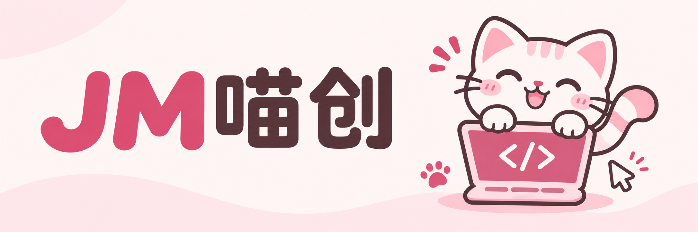

  

<strong>把想法，写成好用的软件。</strong>

  <a href="https://github.com/dongyi00323-dev?tab=repositories">查看公开仓库</a> ·
  <a href="https://github.com/dongyi00323-dev?tab=overview">关注开发动态</a>

### 你好，我是 JM喵创 🐾

写代码，做工具，让想法一点点落地。

这里会持续整理我的项目、开发记录和实践心得。希望每一份作品，都能让具体的事情变得简单一点。

### 我关注的方向

| 方向 | 希望做好的事 |
| :--- | :--- |
| 软件定制 | 从真实需求出发，把流程做顺、把功能做实 |
| 实用工具 | 减少重复操作，让日常工作轻松一点 |
| 开发记录 | 记录实现过程，也分享解决问题的方法 |

### 作品慢慢上新

公开项目正在整理。准备好后，会在这里介绍它解决的问题、使用方式和项目入口。

### 一起交流

欢迎关注后续更新。公开项目开放后，可以通过对应仓库的 Issues 交流想法与建议。

认真做软件，也留一点可爱。

